## Hi, I'm Wenyi 👋

MFE candidate at **UC Berkeley Haas** · B.S. from the **University of Michigan, Ann Arbor**.
I work on quantitative trading, risk, and machine learning for markets.

<picture>
  <source media="(prefers-color-scheme: dark)" srcset="https://raw.githubusercontent.com/yewenyiywy/yewenyiywy/output/kline-dark.svg?v=ma7">
  
</picture>

My GitHub activity, traded as a stock: price = contributions over the last 7 days, one candle per week. Regenerated daily by a GitHub Action.
